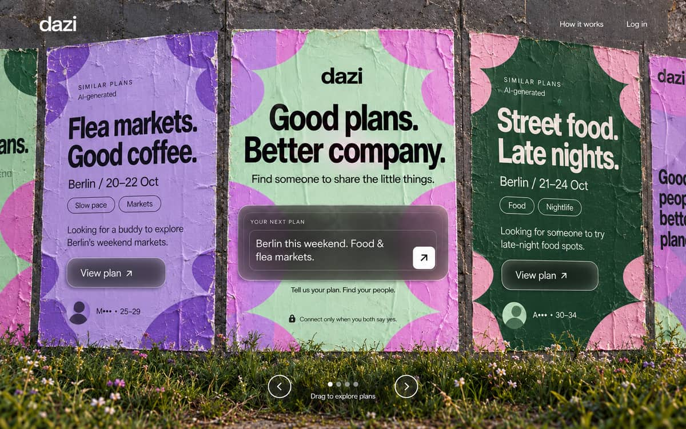
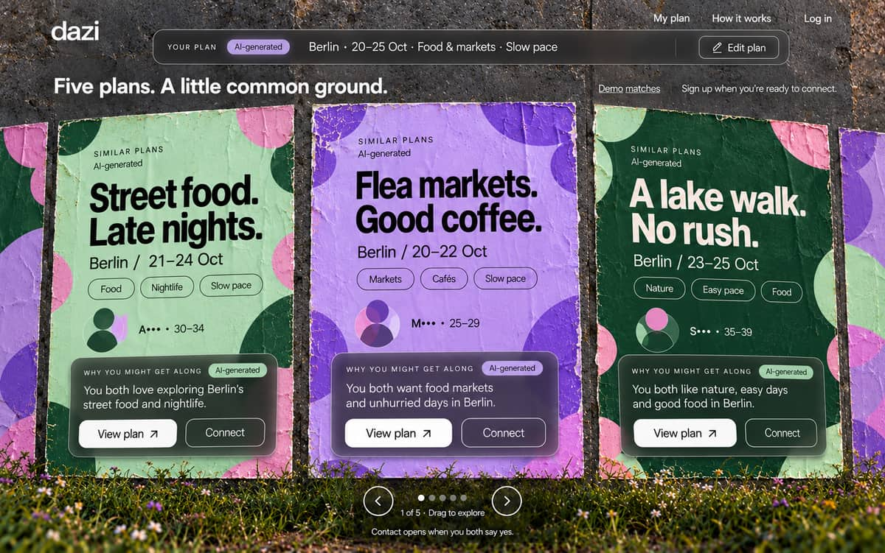
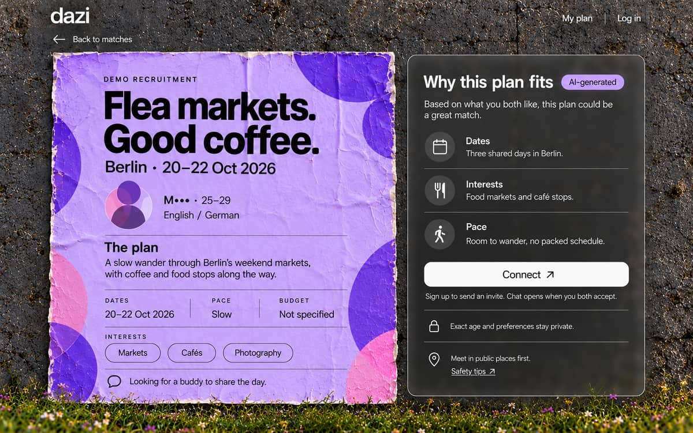
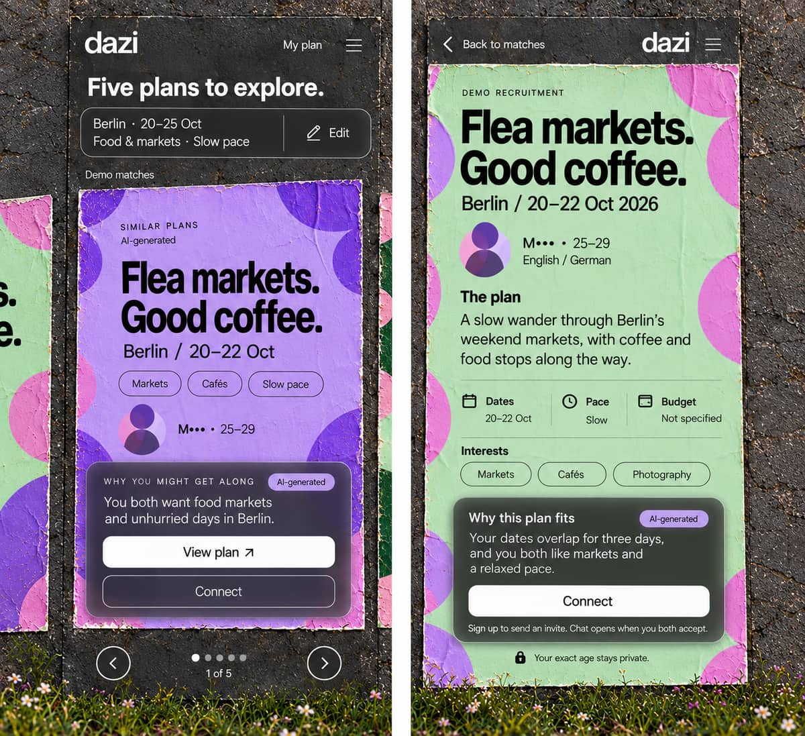

# Dazi — Design system

The visual language of Dazi, extracted from the approved design kit (made with GPT, Oct 2026) and ported into this app. **Build every new screen from these tokens and components.** Code lives in `app/_components/dazi/` (components) and `app/_styles/dazi-*.css` (styles, all scoped under `.dazi-root`).

Reference images (compressed copies of the approved concepts):

| Homepage | Matches | Plan detail | Mobile |
|---|---|---|---|
|  |  |  |  |

## 1. Direction
- **Tactile pasted-paper posters on a dark concrete wall**, wild grass along the bottom.
- **Smoked glass** panels with a thin reflective double border; **neutral white** controls.
- Poster artwork in **lavender / forest / mint / pink**, with large soft motif circles in the corners and fine paper creases.
- **No** sky, **no** orange UI, **no** generic ivory card layouts.
- **A recruitment keeps its colour when opened** (poster on `/matches` → same tone on `/plans/[id]`).
- Real HTML text and controls on top of the materials — never screenshots of a design.

## 2. Tokens

### Colours
| Token | Value | Use |
|---|---|---|
| `--wall` | `#333630` | page background (behind the wall photo) |
| `--ink` | `#161b17` | text on light posters |
| `--cream` | `#fcfaf5` | text on the wall and glass |
| `--muted` | `#d9dcd6` | secondary text on glass / wall |
| `--error` | `#ffc2c2` | form errors on glass |
| `--ai` | `#d5b9ed` | AI badge background |
| glass | `linear-gradient(145deg, #323536ed, #28252fe0)`, border `#ffffff90`, inner border `#ffffff25`, blur 15px | panels |

### Poster tones (only these four)
| Tone | Paper | Text | Motif A | Motif B |
|---|---|---|---|---|
| `lavender` | `#c5aee0` | ink | `#8d63d2` | `#e3a1cf` |
| `forest` | `#214d38` | `#fff7e9` | `#e7a9c9` | `#a9d8b4` |
| `mint` | `#c3e4c7` | ink | `#e494d4` | `#a77fd6` |
| `pink` | `#e7b4c6` | ink | `#b48be0` | `#7e57c2` |

The four tones are also the **post covers** in part C: AI suggests a tone from the trip's mood, the user can change it (SPEC §0.2 C).

### Type
- **Headings:** Manrope 800, letter-spacing −0.045em, line-height 1.04 (`--font-dazi-heading`).
- **Body:** DM Sans (`--font-dazi-body`). Both loaded with `next/font/google` in `app/layout.tsx`.
- **Scale:** poster headline 36–49px (40px mobile) · detail headline 40–61px · results title 30px · section h2 23px · body 15–17px · small 13px · **eyebrow 12px**, caps, +1.6px tracking.
- **Minimum text size: 12px.** No exceptions (the kit had 8–11px; all raised).
- Poster headlines are **two short lines**, each ending with a full stop: "Flea markets." / "Good coffee."

### Shape & spacing
Radius: glass 20px (inner border 14px), buttons/inputs 12px, tags 30px, badges 5–6px. Touch targets **≥ 44px** (buttons 48px). Page gutter 5vw desktop, 20px mobile.

## 3. Components (`app/_components/dazi/`)
| Component | File | Notes |
|---|---|---|
| `SiteShell` | `site-shell.tsx` | Wall background + header (wordmark, "How it works", auth links) + footer ("Your privacy, first"). `variant="wall" \| "calm"`; `demo` switches the footer to "Fictional demo data · no invites are sent". |
| `Paper` | `primitives.tsx` | Poster: `tone`, irregular clip-path edge, motif circles, and the **wet-pasted paper texture** (`wet-pasted-paper-v1.webp`, neutral grey) laid over the colours with `mix-blend-mode: soft-light` at 86% — creases, not baked-in content; mirrored on every second carousel poster so neighbours don't look identical. |
| `.glass` | CSS class | Smoked glass with double border. Use for panels, the plan input, match reasons. |
| Buttons | CSS classes | `.primary-button` (white, the one main action), `.outline-button` (secondary), `.round-button` (carousel arrows), `.text-button` (inline actions). |
| `Tags` | `primitives.tsx` | Outlined pills in `currentColor`, as a `<ul>`. Interests, languages. |
| `AIBadge` | `primitives.tsx` | "AI-generated", lavender chip. **Required next to every AI-written text** (match reasons, overlaps, summaries, icebreakers) — EU AI Act Art. 50. |
| `DemoBadge` | `primitives.tsx` | Outlined "Demo profile" / "Demo matches". **Required on every fictional fixture.** |
| `AbstractAvatar` | `primitives.tsx` | Two overlapping circles. **Never a face or photo** for guests or public profiles. |
| `Identity` | `primitives.tsx` | `M••• · 25–29` + languages. Initial only, age range only. |
| `Headline` | `primitives.tsx` | Two-line poster headline (`h1` or `h2`). |
| `InfoDialog` / `InfoButton` | `info-dialog.tsx` | Native `<dialog>`: Escape + backdrop close, focus returns to the opener. Texts in `copy.ts`. |
| `PosterCarousel` | `poster-carousel.tsx` | Active poster frontal, neighbours angled (±14°, ±22°). Drag/swipe, arrow keys, wraparound, dots + live "2 of 5" text. Arrows at the left/right edges, vertically centred (desktop); beside the dots under the poster (≤ 800px). Non-active posters' controls are untabbable. `positionKey` remembers the poster across detail ↔ back. |
| `PlanComposerContent` | `plan-composer.tsx` | "Good plans. Better company." + "Your next plan" input. Keeps the text in sessionStorage (`dazi:plan:v1`). |
| `TripPosterContent`, `HomeWall`, `MatchesWall`, `PlanDetail` | `trip-poster.tsx`, `walls.tsx` | Page-level views. All take a **required** `demo` prop. |

## 4. Page variants
- **Wall** (`/`, `/matches`, `/plans/[id]`): the poster carousel on the wall. A fixed dark overlay sits over the photo (`#0e100e` at 80% → 40% → 50%) so white text placed directly on the wall stays readable.
  - **Viewport fit:** poster height follows the window (`--stage-h`: `100dvh − 290px` on `/`, `100dvh − 360px` on `/matches`, clamped 520–690px) and the width follows the height (`× 0.72`, max 30vw). At 1440×900 the whole wall — header, three whole posters, controls, footer — fits without vertical scrolling. Phones (≤ 800px) use a fixed 640px stage and scroll normally.
  - **Demo honesty:** demo results say "Fictional examples · Not matched to your input"; the author's text is labelled ("Fictional author's plan"), separate from the AI explanation.
- **Calm** (`/login`, `/signup`, `/onboarding`, `/me/edit`, `/u/[id]`, `/home`): same wall with a **stronger overlay** (88% → 77% → 60%), and one centred smoked-glass panel (`.calm-panel`, 760px; `data-width="narrow"` = 480px for auth). Forms use `.dazi-form`, `.field`, `.field-help`, `fieldset`, `.choice-group` (checkboxes/radios shown as tags — still real inputs with visible focus), `.form-error`, `.form-success`.

## 5. Rules for extending
1. Use the tokens and components above; add a new token only when no existing one fits, and document it here.
2. New poster-like content uses one of the **four tones**; never invent a fifth.
3. Every AI-written text carries `AIBadge`. Text written by a user (a post description) never does — keep the two visibly distinct.
4. Fictional data always carries `DemoBadge`, and the page footer says so (`SiteShell demo`).
5. Guests see **anonymised data only, redacted on the server** — initial, age range, abstract avatar. CSS blur is not privacy.
6. Text ≥ 12px; contrast ≥ 4.5:1 (body) — re-run the contrast check (§6) when adding colour pairs.
7. Touch targets ≥ 44px; everything reachable by keyboard with a visible focus ring; respect `prefers-reduced-motion` (already global in `dazi-base.css`).
8. Mobile (≤ 800px): one legible poster plus neighbouring slivers; details stack and scroll; no horizontal page scroll.
9. Forms stay plain HTML posted to server actions; styling never changes field names or validation.
10. Import styles only through `app/globals.css` (one global load; avoids Next 16 stylesheet ordering issues).

## 6. Accessibility — contrast (WCAG AA)
Computed for every text/background token pair (glass blended over the wall and over a light poster; placeholders blended with their alpha):

| Pair | Ratio | AA (4.5:1 body) |
|---|---|---|
| Ink on lavender paper | 8.73:1 | ✅ pass |
| Ink on mint paper | 12.67:1 | ✅ pass |
| Ink on pink paper | 9.76:1 | ✅ pass |
| Cream on forest paper | 9.04:1 | ✅ pass |
| White on glass (over wall) | 12.37:1 | ✅ pass |
| White on glass (over light poster) | 10.72:1 | ✅ pass |
| Muted text #d9dcd6 on glass | 8.93:1 | ✅ pass |
| Placeholder on input | 6.36:1 | ✅ pass |
| White on input | 9.67:1 | ✅ pass |
| Error #ffc2c2 on glass | 8.10:1 | ✅ pass |
| AI badge text on badge | 9.19:1 | ✅ pass |
| Primary button text on white | 17.09:1 | ✅ pass |
| White on modal #2b3030 | 13.39:1 | ✅ pass |

Text directly on the wall photo is protected by the fixed overlay (§4) and checked visually (time-boxed; a measured check can follow in the 19 Oct polish pass).

## 7. Assets
| File | Source | Processing |
|---|---|---|
| `public/dazi/wall-grass.webp` (≈ 250 KB) | kit `public/dazi/wall-grass.png` (3.6 MB, 1586×992) | `sharp(...).webp({ quality: 60, effort: 6 })` |
| `public/dazi/wet-pasted-paper-v1.webp` (≈ 230 KB, 1024×1536) | AI-generated grayscale texture (made with Codex's image tool, 17 Oct 2026, after the user's wet-glued poster reference): front-on macro photo of thin paper wheat-pasted onto a flat wall — long slender vertical wrinkles, tapered diagonal tension creases, soft bulges, neutral grey `#808080`, no text or pattern | WebP; no source PNG is kept in the repo |
| `docs/design/reference/*.jpg` (140–210 KB each) | kit `reference/*.png` (≈ 3 MB each) | `sharp(...).resize({ width: 1200 }).jpeg({ quality: 68, mozjpeg: true })` |

`sharp` ships with Next.js, so no extra dependency. The original kit stays outside the repo (`~/Turing/Final-Sprint-Project/dazi-design-kit/`).
